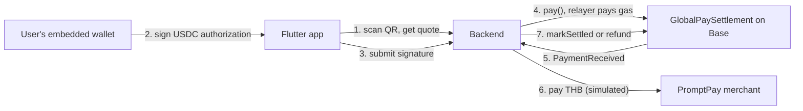

# GlobalPay

**Hold stablecoins, pay any local merchant QR.** The merchant receives local currency and never touches crypto.

The first target is foreign remote workers in Thailand who are paid in USDC. They pay any PromptPay QR from the GlobalPay app, and the merchant receives baht. It runs on **Base**, an Ethereum Layer 2 that uses the EVM.

> **Status: iteration 6 of 11 done.** Iterations 6–11 turn the demo into a product (see the roadmap).
> - The architecture skeleton and docs are in place.
> - The settlement contract is implemented and fully tested.
> - The backend signs users in, runs mock KYC, and returns signed quotes for PromptPay QRs.
> - The full payment loop works on a local chain: pay, simulated baht payout, then settle or refund.
> - The Flutter app runs the whole flow on the Android emulator: sign in, KYC, scan, confirm, pay, and follow the payment until it settles.
> - Payouts are confirmed, not trusted: idempotent retries, an UNKNOWN outcome that's never settled or refunded automatically, partner webhooks, and an operator console. A Xendit sandbox adapter is in place but not yet run against Xendit.
>
> Nothing moves real money. Partners (exchange, e-money operator, PromptPay payout, KYC) are simulated, and everything runs on testnet or a local chain.

## How a payment works



1. The user scans a PromptPay QR. The backend locks a USDC/THB quote for 60 seconds and signs it.
2. The user's wallet signs a gasless USDC authorisation (EIP-3009) bound to that one quote.
3. The backend relayer submits it. The settlement contract pulls the USDC.
4. The (simulated) partner pays the merchant in baht. The contract then sends the USDC to the treasury, or refunds the user if the payout failed.

## Repository layout

| Path | What | Stack |
|---|---|---|
| [`apps/mobile`](apps/mobile) | User app | Flutter, Riverpod, go_router |
| [`services/api`](services/api) | Quotes, relayer, indexer, payouts | TypeScript, Fastify, viem, Prisma/Postgres |
| [`contracts`](contracts) | Settlement contract | Solidity, Foundry, OpenZeppelin |
| [`packages/fixtures`](packages/fixtures) | Shared PromptPay QR test vectors | JSON |
| [`docs`](docs) | Scope, architecture, decisions, roadmap, setup | Markdown |

## Docs

- [Product scope](docs/scope.md): the idea, markets, risks and chosen direction
- [Architecture](docs/architecture.md): components, payment flow, state machines, signatures, keys and roles
- [Decision records](docs/adr): Base, gasless USDC, embedded wallet, TypeScript backend, partner ports, immutable contract, chain as source of truth
- [Roadmap](docs/roadmap.md): the build in iterations, with action steps
- [Research: production rails](docs/research/production-rails.md): payout partners, onramps and tap-to-pay, with endpoints and regulation
- [Setup](docs/setup.md): toolchain and how to run each part

## Quick start

Clone, then fetch the contract libraries (git submodules):

```bash
git clone https://github.com/aagneye/global-pay.git
```

```bash
cd global-pay && git submodule update --init
```

```bash
docker compose up -d
```

```bash
cd contracts && forge test
```

```bash
cd services/api && npm install && npm test
```

If port 5432 is already in use, see [docs/setup.md](docs/setup.md#2-database).

```bash
cd apps/mobile && flutter pub get && flutter test
```

See [docs/setup.md](docs/setup.md) for the full setup, including the Android toolchain and Foundry.
