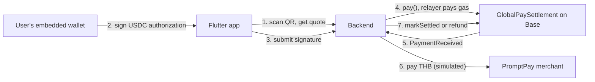

# GlobalPay

**Hold stablecoins, pay any local merchant QR.** The merchant receives local currency and never touches crypto.

The first target is foreign remote workers in Thailand who are paid in USDC. They pay any PromptPay QR from the GlobalPay app, and the merchant receives baht. It settles on **NEAR** (testnet, the NEAR Hackathon entry below) or on **Base**, an Ethereum Layer 2, chosen by `SETTLEMENT_RAIL`.

## NEAR Hackathon: GlobalPay on NEAR (track: Real-World Money)

**The problem.** Foreign remote workers in Thailand get paid in USDC, but every café, taxi and market stall takes a PromptPay QR, and none takes USDC.

**The product.** GlobalPay lets you scan any Thai PromptPay QR and pay with USDC. The merchant receives baht and changes nothing.

**How NEAR fits.** Everything below was built during the hackathon window; the repo itself starts on 2026-11-12, after the announcement.
- **A settlement contract on NEAR** ([`contracts-near/settlement`](contracts-near/settlement)), written in Rust with near-sdk 5. USDC (NEP-141) reaches it through `ft_transfer_call`, together with a quote that the backend signs with ed25519. The contract checks:
  - the signature, on-chain with `env::ed25519_verify`;
  - the payer, the amount and the expiry;
  - that the quote is used only once.

  It then records the payment and logs a NEP-297 event. After the baht payout, the operator calls `settle` (the USDC goes to the treasury). If the payout failed, it calls `refund` (the USDC goes back to the payer). A failed transfer rolls the status back.
- **Gasless payments.** The phone signs a **NEP-366 meta transaction** (a `DelegateAction` for `ft_transfer_call`). The GlobalPay relayer submits it and pays the gas, so the user never holds NEAR.
- **Sign-in without a seed phrase.** **NEP-413** signed messages, using the phone's ed25519 key. The account is the key's implicit account, and the key is sealed by the phone's fingerprint hardware where one is set up.
- **Test USDC** ([`contracts-near/test-usdc`](contracts-near/test-usdc)): a NEP-141 token used on testnet only.

**Deployed on NEAR testnet:**
- settlement contract: [`gp-oy8fad-settle.testnet`](https://testnet.nearblocks.io/address/gp-oy8fad-settle.testnet)
- test USDC: [`gp-oy8fad-usdc.testnet`](https://testnet.nearblocks.io/address/gp-oy8fad-usdc.testnet)
- a ฿100 payment, Paid then Settled: [payment (meta transaction)](https://testnet.nearblocks.io/txns/3iqZySU1L7h4ZnxRK4VpqTjPeRzkdCrAody9u3Uv4EYw) and [settlement](https://testnet.nearblocks.io/txns/Dnhybx9aZb51MjmQ9jyLQdo7T3ScjrHfrThg5zTjvLfT); the treasury received 2.978891 USDC
- a ฿100 payment whose payout failed (forced), then Refunded: [payment](https://testnet.nearblocks.io/txns/FFcw2gLVDNHNZTLD8xjW3VT6iGwrJbqow3HCWsFgQEy9) and [refund](https://testnet.nearblocks.io/txns/AYFScijZtFBpN7ME7FM35zAw2U6KLvB7ZTxpwjzgrksN)

**Try it ("do X, see Y"):**
1. **Contracts.** Run `cd contracts-near && cargo test`: 44 tests pass. Prebuilt wasm files are in `contracts-near/res/`.
2. **Deploy your own copy on testnet** (free, using faucet accounts). In `services/api`, run `npm install`, then `npm run near:testnet -- init`, `create`, `deploy` and `status`. You'll see both contracts initialised.
3. **Backend.** Start a Postgres database (see `services/api/README.md`; `npx prisma dev` works), set its `DATABASE_URL` in `.env.near-testnet`, then run `npx prisma migrate deploy` and `npm run start:near`. `GET http://localhost:3001/health` returns `ok`.
4. **App** (Android emulator). In `apps/mobile`, run `flutter run --dart-define=SETTLEMENT_RAIL=near --dart-define=API_BASE_URL=http://10.0.2.2:3001 --dart-define=NEAR_USDC_CONTRACT=<usdc> --dart-define=NEAR_SETTLEMENT_CONTRACT=<settle> --dart-define=NEAR_SIGN_IN_RECIPIENT=globalpay.local`, adding `--no-enable-impeller` on Android 17 emulators. Then:
   - tap **Continue with NEAR testnet wallet**; you'll see 1,000 test USDC;
   - tap **Scan & pay** and paste a QR from `npm run qr:make` (in `services/api`);
   - tap **Pay**;
   - the status moves through Paid, Merchant paid and Settled, with nearblocks links.
5. **A refund.** Restart the backend with `PAYOUT_FAILURE_RATE=1` set in the shell (it overrides the file), then pay again. You'll see **Refunded**, and the USDC is back in your balance.

**Being upfront:**
- **Testnet only.** The baht payout partner is simulated, so no real money moves.
- **Another rail exists.** The repo also has an earlier EVM rail (Base, Solidity, EIP-3009). It's still selectable with `SETTLEMENT_RAIL=evm`, but **only the NEAR rail is the hackathon entry** (rules Q-002).
- **Libraries:** near-sdk and near-contract-standards (Rust), near-api-js (TypeScript), blockchain_utils (Dart), Fastify, Prisma and Flutter.
- **AI assistance:** the code was written with Claude Code (Q-005).
- **License:** MIT ([LICENSE](LICENSE)).


> **Status: iterations 1–6 and 8–11 of 11 done.** Iteration 7 (Base Sepolia) is ready and waits on testnet funding. A signed release needs the owner's upload key, and email sign-in needs the owner's Privy app (see the roadmap).
> - The architecture skeleton and docs are in place.
> - The settlement contract is implemented and fully tested.
> - The backend signs users in, runs mock KYC, and returns signed quotes for PromptPay QRs.
> - The full payment loop works on a local chain: pay, simulated baht payout, then settle or refund.
> - The Flutter app runs the whole flow on the Android emulator: sign in, KYC, scan, confirm, pay, and follow the payment until it settles.
> - Tap to pay: hold phones together (or scan a QR) to identify the payer, who approves a gasless USDC transfer.
> - Add money: buy USDC through MoonPay (or a local simulator), shown as added only once the USDC is proved on-chain; incoming deposits show in history.
> - Payouts are confirmed, not trusted: idempotent retries, an UNKNOWN outcome that's never settled or refunded automatically, partner webhooks, and an operator console. A Xendit sandbox adapter is in place but not yet run against Xendit.
> - Production hardening: rate limits, log redaction, production refusing test settings, release builds with HTTPS only, no test keys, R8 and a release key, and an app that checks what its wallet signs.
> - Sign-in with an email code through Privy's embedded wallet; the dev wallet remains for debug builds and tests.
>
> Nothing moves real money. Partners (exchange, e-money operator, PromptPay payout, KYC) are simulated, and everything runs on testnet or a local chain.

## How a payment works



1. The user scans a PromptPay QR. The backend locks a USDC/THB quote for 60 seconds and signs it.
2. The user's wallet signs a gasless USDC authorisation (EIP-3009) bound to that one quote.
3. The backend relayer submits it. The settlement contract pulls the USDC.
4. The (simulated) partner pays the merchant in baht. The contract then sends the USDC to the treasury, or refunds the user if the payout failed.

## Repository layout

| Path | What | Stack |
|---|---|---|
| [`apps/mobile`](apps/mobile) | User app | Flutter, Riverpod, go_router |
| [`services/api`](services/api) | Quotes, relayer, indexer, payouts | TypeScript, Fastify, viem, Prisma/Postgres |
| [`contracts`](contracts) | Settlement contract | Solidity, Foundry, OpenZeppelin |
| [`packages/fixtures`](packages/fixtures) | Shared PromptPay QR test vectors | JSON |
| [`docs`](docs) | Scope, architecture, decisions, roadmap, setup | Markdown |

## Docs

- [Product scope](docs/scope.md): the idea, markets, risks and chosen direction
- [Architecture](docs/architecture.md): components, payment flow, state machines, signatures, keys and roles
- [Decision records](docs/adr): Base, gasless USDC, embedded wallet, TypeScript backend, partner ports, immutable contract, chain as source of truth, payout outcomes, Add money proved on-chain, tap to pay
- [Roadmap](docs/roadmap.md): the build in iterations, with action steps
- [Research: production rails](docs/research/production-rails.md): payout partners, onramps and tap-to-pay, with endpoints and regulation
- [Setup](docs/setup.md): toolchain and how to run each part
- [Base Sepolia runbook](docs/testnet.md): keys, funding, deployment, and an end-to-end payment on testnet
- [Threat model](docs/security.md): assets, actors, trust boundaries, and threats per component with today's controls and the gaps
- [Key rotation runbook](docs/runbooks/key-rotation.md): replacing every key and secret safely, and what to do if one leaks
- [Launch checklist](docs/launch-checklist.md): what must be true before real money, as automated checks and sign-offs

## Quick start

Clone, then fetch the contract libraries (git submodules):

```bash
git clone https://github.com/aagneye/global-pay.git
```

```bash
cd global-pay && git submodule update --init
```

```bash
docker compose up -d
```

```bash
cd contracts && forge test
```

```bash
cd services/api && npm install && npm test
```

If port 5432 is already in use, see [docs/setup.md](docs/setup.md#2-database).

```bash
cd apps/mobile && flutter pub get && flutter test
```

See [docs/setup.md](docs/setup.md) for the full setup, including the Android toolchain and Foundry.
