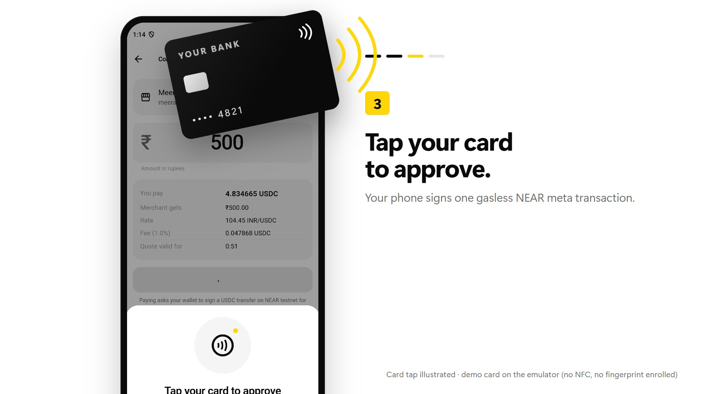
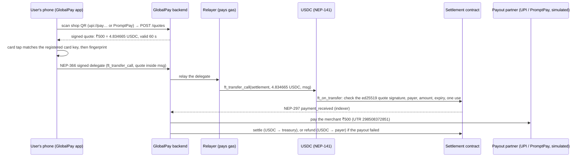
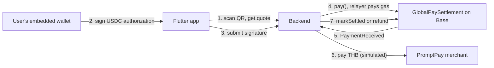

# GlobalPay

> **NEAR Hackathon entry · track: Real-World Money (`realworld`) · live on NEAR testnet · MIT**

## For judges: review in 5 minutes

[](docs/demo/globalpay-demo.mp4)

**▶ [Watch the 75-second demo](docs/demo/globalpay-demo.mp4).** It shows the real app on an Android emulator. You register a bank card as your key, scan a shop's UPI QR, enter ₹500, tap the card, and the merchant is paid in rupees, all on NEAR testnet.

| | |
|---|---|
| **The problem** | Many people now hold their money in stablecoins (USDC), but shops take local QR payments in local currency. No chai stall in India or café in Thailand takes USDC. |
| **What GlobalPay does** | You scan the QR the shop already shows (India's **UPI**, Thailand's **PromptPay**) and pay in USDC. You approve with a tap of **your own contactless bank card** (it becomes your wallet key) plus your fingerprint. The shop receives **rupees or baht** and changes nothing. |
| **How NEAR is used** | Our own **settlement contract** in Rust ([`contracts-near/settlement`](contracts-near/settlement)) receives **NEP-141 USDC** via `ft_transfer_call` and checks a backend-signed quote on-chain (`env::ed25519_verify`). Payments are **gasless NEP-366 meta transactions**: the phone signs, our relayer pays the gas. Sign-in is **NEP-413**, with no seed phrase. The contract logs **NEP-297** events, then `settle` sends the USDC to the treasury or `refund` returns it to the payer. |
| **Deployed (testnet)** | settlement [`gp-oy8fad-settle.testnet`](https://testnet.nearblocks.io/address/gp-oy8fad-settle.testnet) · test USDC [`gp-oy8fad-usdc.testnet`](https://testnet.nearblocks.io/address/gp-oy8fad-usdc.testnet) |
| **Live proof on nearblocks** | **₹500 UPI payment** (the one in the video): [pay](https://testnet.nearblocks.io/txns/8aSGmFLCsCy8kcnQ8445DF5M2VpCphmqRwpzyNNTUmqT) → [settle](https://testnet.nearblocks.io/txns/CRSZyQaRULLJ3kKRm41gQNtGXmiC6dvS5tBy1m8BNC4F) · **฿100 PromptPay payment**: [pay](https://testnet.nearblocks.io/txns/3iqZySU1L7h4ZnxRK4VpqTjPeRzkdCrAody9u3Uv4EYw) → [settle](https://testnet.nearblocks.io/txns/Dnhybx9aZb51MjmQ9jyLQdo7T3ScjrHfrThg5zTjvLfT) · **failed payout → refund**: [pay](https://testnet.nearblocks.io/txns/FFcw2gLVDNHNZTLD8xjW3VT6iGwrJbqow3HCWsFgQEy9) → [refund](https://testnet.nearblocks.io/txns/AYFScijZtFBpN7ME7FM35zAw2U6KLvB7ZTxpwjzgrksN) |
| **Real vs simulated** | **Real:** the contracts, every NEAR transaction above, the Flutter app, the TypeScript backend, live USDC/INR and USDC/THB rates, and the NFC/EMV card reading code. **Simulated (testnet):** the UPI and PromptPay payout partners, KYC, and the test USDC token. The emulator has no NFC, so the video uses the app's testnet demo card. |
| **Tests** | Contract **72** passing · backend **585** passing · app **513** passing. Edge cases are listed [below](#test-coverage). |
| **Built in the window** | The repo's first commit is on 2026-11-12. The NEAR work to judge is [`pre-near...hackathon-submission`](https://github.com/aagneye/global-pay/compare/pre-near...hackathon-submission) (rules Q-001 to Q-003). |
| **Team** | Built by [@aagneye](https://github.com/aagneye), with Claude Code as the coding assistant (disclosed per Q-005). |

### Check it yourself
| Do this | You'll see |
|---|---|
| Open the **₹500 pay** link above | `ft_transfer` of 4.834665 USDC into `gp-oy8fad-settle.testnet`, then a `payment_received` event with `fiat_currency: INR`, `fiat_amount: 50000` (paise) |
| Open the **settle** link | the USDC moves to `gp-oy8fad-treasury.testnet`; `settle` returns `true` |
| `cd contracts-near && cargo test` | 72 tests pass, 1 ignored (a known issue, listed below) |
| `cd services/api && npm ci && npm test` | 585 tests pass; 23 are skipped (the Postgres-only suites, plus 1 known issue) |
| `cd apps/mobile && flutter pub get && flutter test` | 513 tests pass; 2 are skipped (the live end-to-end test, plus 1 known issue) |
| Run it end to end | follow [Try it](#try-it-do-x-see-y) below: deploy your own contracts on testnet for free, start the backend, run the app, pay a UPI QR |

### A payment on the NEAR rail


### Test coverage
Seven areas were tested with edge cases, each by its own agent, then merged:

| Area | What the tests cover |
|---|---|
| **NFC card key** (app) | NFC missing or switched off; tag lost mid-read; NTAG/MIFARE tags fall back to the UID; random-UID cards; two taps; cancel; platform errors; wrong card means nothing is signed; only a salted hash plus the last 4 digits is stored; demo card on testnet only |
| **EMV reader** (app) | PPSE/PSE, AID priority, PDOL, GPO templates 77/80, READ RECORD, 6Cxx/61xx status words, Luhn, PAN never logged |
| **QR parsing and scan** (app) | 66 UPI cases (case, encoding, bad VPAs, currencies, amounts, repeated fields), 34 PromptPay cases (CRC, truncated TLV, currencies), the scan screen (camera denied, double scans, static vs dynamic amounts) |
| **Login** (app + backend) | Nonce expiry and reuse, wrong recipient, foreign keys, malformed signatures, faucet down, JWT tampering and expiry, per-IP rate limits |
| **Payments** (app) | Quote expiry, 10 tampered `nearPayment` variants (nothing signed), dropped connections without double charges, status polling to Settled, Refunded, Failed or Needs review, history in mixed ₹ and ฿ |
| **Payments and payouts** (backend) | Replayed and tampered delegates, other users' quotes, RPC failures (never stuck), settle returning `false`, UPI payout idempotency, UNKNOWN never auto-settled, KYC limits across ₹ and ฿, rate feed down |
| **Settlement contract** | INR accepted; 14 bad currencies refused; nanosecond expiry boundary; `u128::MAX` amounts; lookalike token callers; replays after settle or refund; operator-only; the gas floor; paging; 20+ bad signatures |

**Bugs the tests found:**
- **Fixed tonight:**
  - A UPI QR with a repeated `pa` field could show one payee in the app while the backend paid another. The app now reads QR fields exactly like the backend.
  - A raw NFC platform error froze the card tap sheet.
  - A non-JSON server error showed the HTTP library's developer text on the sign-in screen.
  - `PAYOUT_UNKNOWN_RATE` didn't reach the UPI simulator.
- **Known, with skipped tests:**
  - The 24-hour KYC total counts paise as satang. It only ever blocks too early, never too late.
  - `MIN_GAS_FOR_PAYOUT` (40 TGas) is below the ~44 TGas `settle` uses. The backend always attaches 100 TGas.
  - One payment in a currency the app doesn't know would hide the history list. Today the backend only sends THB and INR.


**A universal crypto spending wallet for the real world.** One wallet. Any compatible contactless card as your key. UPI or PromptPay QR. Crypto in, local currency out.

Your existing bank card becomes a physical key to your crypto wallet. Your smartphone becomes the payment interface. Your USDC becomes spendable at physical shops that show a UPI or PromptPay QR, and the merchant receives local currency: rupees in India, baht in Thailand. The merchant never touches crypto and installs nothing.

- **Live on NEAR testnet:** Indian **UPI** QRs (merchant paid in ₹) and Thai **PromptPay** QRs (merchant paid in ฿), paid in USDC with gasless NEAR meta transactions. The payout partners are simulated.
- **Your existing card is your key:** tap your contactless debit or credit card on your phone to register it. Every payment then needs that same card tap and your fingerprint. No special crypto card.
- **Next:** contactless at the shop's card terminal (tap your phone at the POS, which needs an approved card-emulation partner), more stablecoins, and more QR rails country by country.

It settles on **NEAR** (testnet, the NEAR Hackathon entry below) or on **Base**, an Ethereum Layer 2, chosen by `SETTLEMENT_RAIL`. UPI and the card key are on the NEAR rail.

## NEAR Hackathon: GlobalPay on NEAR (track: Real-World Money)

**The problem.** More and more people hold their money in stablecoins: remote workers paid in USDC, travellers, people saving in dollars. But the shops around them, from a chai stall in Bengaluru to a café in Bangkok, take local QR payments in local currency, and none of them takes USDC. Spending crypto today means a special crypto card, a seed phrase, or a trip to an exchange.

**The product.** GlobalPay makes the card already in your pocket the key to your crypto wallet. Scan the QR the shop already shows (UPI in India, PromptPay in Thailand), tap your own contactless bank card on your phone, and approve with your fingerprint. You pay in USDC. The merchant receives rupees or baht and changes nothing.

**What is judged, and the diff (rules Q-001 to Q-003).** The whole repo was written in the hackathon window: its first commit is on 2026-11-12, after the 2026-10-19 announcement. The earlier EVM rail is another chain (Q-002), so the part to judge is the NEAR work: every commit from tag `pre-near` (the last commit before any NEAR code) to tag `hackathon-submission`. [See the diff on GitHub](https://github.com/aagneye/global-pay/compare/pre-near...hackathon-submission).

**Track hints used (Real-World Money):** stablecoins (NEP-141 USDC) and meta transactions (NEP-366, the relayer pays the gas). NEAR Intents has no testnet (Q-007), so settlement runs on our own contract (Q-011).

**How NEAR fits.**
- **A settlement contract on NEAR** ([`contracts-near/settlement`](contracts-near/settlement)), written in Rust with near-sdk 5. USDC (NEP-141) reaches it through `ft_transfer_call`, together with a quote that the backend signs with ed25519. The contract checks:
  - the signature, on-chain with `env::ed25519_verify`;
  - the payer, the amount and the expiry;
  - that the quote is used only once.

  It then records the payment and logs a NEP-297 event. After the local-currency payout (₹ or ฿), the operator calls `settle` (the USDC goes to the treasury). If the payout failed, it calls `refund` (the USDC goes back to the payer). A failed transfer rolls the status back. The quote names its currency (any 3-letter code), so one contract serves every rail.
- **Gasless payments.** The phone signs a **NEP-366 meta transaction** (a `DelegateAction` for `ft_transfer_call`). The GlobalPay relayer submits it and pays the gas, so the user never holds NEAR.
- **Sign-in without a seed phrase.** **NEP-413** signed messages, using the phone's ed25519 key. The account is the key's implicit account, and the key is sealed by the phone's fingerprint hardware where one is set up.
- **Test USDC** ([`contracts-near/test-usdc`](contracts-near/test-usdc)): a NEP-141 token used on testnet only.

**Pay any UPI QR.**
- Scan or paste a standard UPI QR: `upi://pay?pa=<vpa>&pn=<name>&am=<amount>&cu=INR&mc=<mcc>&tr=<ref>`. If it has no amount, you type one.
- The backend (`POST /quotes`) reads it, prices USDC in rupees from Coinbase's public rate feed, and signs the quote.
- You sign a gasless NEP-366 meta transaction, exactly as for PromptPay. The same settlement contract records the payment; it needed no change for rupees.
- A simulated UPI payout partner pays the merchant in rupees and returns a 12-digit UTR (the UPI reference). The operator then calls `settle`, or `refund` if the payout failed.

**Your card is your key.**
- Register your card right after your first sign-in (you can skip), or later from **Home → Card key**: tap your contactless debit or credit card on the back of the phone.
- The app reads the card over NFC (reader mode): the card number (the EMV PAN, over ISO-DEP), or the tag's UID if it can't.
- It keeps only `sha256(device salt ‖ identifier)` and the last 4 digits, in the phone's secure storage. The card number is never stored or sent anywhere.
- Every payment then asks for the same card tap, before the fingerprint check and the signature. Another card doesn't match, so nothing is signed.
- The Android emulator has no NFC, so testnet builds offer a **demo card**.

**Deployed on NEAR testnet:**
- settlement contract: [`gp-oy8fad-settle.testnet`](https://testnet.nearblocks.io/address/gp-oy8fad-settle.testnet)
- test USDC: [`gp-oy8fad-usdc.testnet`](https://testnet.nearblocks.io/address/gp-oy8fad-usdc.testnet)
- a ₹500 UPI payment to a made-up merchant (Meera Chai), approved with the card key, Paid then Settled: [payment (meta transaction)](https://testnet.nearblocks.io/txns/8aSGmFLCsCy8kcnQ8445DF5M2VpCphmqRwpzyNNTUmqT) and [settlement](https://testnet.nearblocks.io/txns/CRSZyQaRULLJ3kKRm41gQNtGXmiC6dvS5tBy1m8BNC4F). The contract records it with `fiat_currency` INR and `fiat_amount` 50000 (paise); the user paid 4.834665 USDC at 104.45 INR/USDC plus a 1% fee, and the simulated UPI partner returned UTR 298508372851
- a ฿100 PromptPay payment, Paid then Settled: [payment (meta transaction)](https://testnet.nearblocks.io/txns/3iqZySU1L7h4ZnxRK4VpqTjPeRzkdCrAody9u3Uv4EYw) and [settlement](https://testnet.nearblocks.io/txns/Dnhybx9aZb51MjmQ9jyLQdo7T3ScjrHfrThg5zTjvLfT); the treasury received 2.978891 USDC
- a ฿100 PromptPay payment whose payout failed (forced), then Refunded: [payment](https://testnet.nearblocks.io/txns/FFcw2gLVDNHNZTLD8xjW3VT6iGwrJbqow3HCWsFgQEy9) and [refund](https://testnet.nearblocks.io/txns/AYFScijZtFBpN7ME7FM35zAw2U6KLvB7ZTxpwjzgrksN)

### Try it: do X, see Y
1. **Contracts.** Run `cd contracts-near && cargo test`: 72 tests pass (1 ignored: a known issue). Prebuilt wasm files are in `contracts-near/res/`.
2. **Deploy your own copy on testnet** (free, using faucet accounts). In `services/api`, run `npm install`, then `npm run near:testnet -- init`, `create`, `deploy` and `status`. You'll see both contracts initialised.
3. **Backend.** Start a Postgres database (see `services/api/README.md`; `npx prisma dev` works), set its `DATABASE_URL` in `.env.near-testnet`, then run `npx prisma migrate deploy` and `npm run start:near`. `GET http://localhost:3001/health` returns `ok`.
4. **App** (Android emulator). In `apps/mobile`, run `flutter run --dart-define=SETTLEMENT_RAIL=near --dart-define=API_BASE_URL=http://10.0.2.2:3001 --dart-define=NEAR_USDC_CONTRACT=<usdc> --dart-define=NEAR_SETTLEMENT_CONTRACT=<settle> --dart-define=NEAR_SIGN_IN_RECIPIENT=globalpay.local`, adding `--no-enable-impeller` on Android 17 emulators. Then:
   - tap **Continue with NEAR testnet wallet**; you'll see 1,000 test USDC (skip the card key offer for now; step 5 sets it up);
   - tap **Scan & pay** and paste a PromptPay QR from `npm run qr:make` (in `services/api`);
   - tap **Pay**;
   - the status moves through Paid, Merchant paid and Settled, with nearblocks links.
5. **A UPI payment, with your card as the key.**
   - register the card key from **Home → Card key** (on the emulator, choose the **demo card**);
   - tap **Scan & pay** and paste `upi://pay?pa=meera.chai@demo&pn=Meera%20Chai&mc=5814&tr=GP0001&cu=INR` (a made-up merchant);
   - enter ₹500 and tap **Pay**;
   - tap your card (the demo card on the emulator), then approve with your fingerprint if the phone has one set up (an emulator without a fingerprint signs right after the card tap);
   - the status moves through Paid, Merchant paid (with the UPI reference) and Settled.
6. **A refund.** Restart the backend with `PAYOUT_FAILURE_RATE=1` set in the shell (it overrides the file), then pay again. You'll see **Refunded**, and the USDC is back in your balance.

**Being upfront:**
- **Testnet only.** The UPI (₹) and PromptPay (฿) payout partners are simulated, so no real money moves.
- **USDC only** for now. More stablecoins are next.
- **The card check is a possession factor that the phone enforces.** It is not a cryptographic proof from the card: EMV cards never expose their keys to apps, so the app compares a salted hash of what it reads. Production would bind the card through issuer tokenisation or the card's dynamic cryptograms.
- **Not built: tapping your phone at a shop's card terminal (POS).** That needs an approved card-emulation partner. The repo's NFC tap to pay is phone to phone, on the EVM rail only (iteration 9).
- **India's rules are out of scope for the demo:** TDS on crypto transfers, FEMA, and RBI/NPCI rules for UPI payouts.
- **Another rail exists.** The repo also has an earlier EVM rail (Base, Solidity, EIP-3009). It's still selectable with `SETTLEMENT_RAIL=evm`, but **only the NEAR rail is the hackathon entry** (rules Q-002).
- **Libraries:** near-sdk and near-contract-standards (Rust), near-api-js (TypeScript), blockchain_utils, nfc_manager and mobile_scanner (Dart), Fastify, Prisma and Flutter.
- **AI assistance:** the code was written with Claude Code (Q-005).
- **License:** MIT ([LICENSE](LICENSE)).


> **Status: iterations 1–6 and 8–11 of 11 done.** Iteration 7 (Base Sepolia) is ready and waits on testnet funding. A signed release needs the owner's upload key, and email sign-in needs the owner's Privy app (see the roadmap).
> - The architecture skeleton and docs are in place.
> - The settlement contract is implemented and fully tested.
> - The backend signs users in, runs mock KYC, and returns signed quotes for PromptPay QRs, and on the NEAR rail for UPI QRs too.
> - The full payment loop works on a local chain: pay, simulated local-currency payout, then settle or refund.
> - The Flutter app runs the whole flow on the Android emulator: sign in, KYC, scan, confirm, pay, and follow the payment until it settles.
> - Tap to pay: hold phones together (or scan a QR) to identify the payer, who approves a gasless USDC transfer.
> - Add money: buy USDC through MoonPay (or a local simulator), shown as added only once the USDC is proved on-chain; incoming deposits show in history.
> - Payouts are confirmed, not trusted: idempotent retries, an UNKNOWN outcome that's never settled or refunded automatically, partner webhooks, and an operator console. A Xendit sandbox adapter is in place but not yet run against Xendit.
> - Production hardening: rate limits, log redaction, production refusing test settings, release builds with HTTPS only, no test keys, R8 and a release key, and an app that checks what its wallet signs.
> - Sign-in with an email code through Privy's embedded wallet; the dev wallet remains for debug builds and tests.
> - NEAR Hackathon: the NEAR rail, UPI QRs and the card key (see the section above).
>
> Nothing moves real money. Partners (exchange, e-money operator, PromptPay and UPI payouts, KYC) are simulated, and everything runs on testnet or a local chain.

## How a payment works

The diagram shows the Base (EVM) rail with a PromptPay QR. On the NEAR rail, step 2 is a NEP-366 meta transaction for `ft_transfer_call`, signed only after the card tap and the fingerprint, and the QR can also be UPI (paid in ₹); see the NEAR section above.



1. The user scans a PromptPay QR. The backend locks a USDC/THB quote for 60 seconds and signs it.
2. The user's wallet signs a gasless USDC authorisation (EIP-3009) bound to that one quote.
3. The backend relayer submits it. The settlement contract pulls the USDC.
4. The (simulated) partner pays the merchant in baht. The contract then sends the USDC to the treasury, or refunds the user if the payout failed.

## Repository layout

| Path | What | Stack |
|---|---|---|
| [`apps/mobile`](apps/mobile) | User app | Flutter, Riverpod, go_router |
| [`services/api`](services/api) | Quotes, relayer, indexer, payouts | TypeScript, Fastify, viem, near-api-js, Prisma/Postgres |
| [`contracts-near`](contracts-near) | NEAR settlement contract and test USDC | Rust, near-sdk 5 |
| [`contracts`](contracts) | Settlement contract on Base | Solidity, Foundry, OpenZeppelin |
| [`packages/fixtures`](packages/fixtures) | Shared PromptPay QR test vectors | JSON |
| [`docs`](docs) | Scope, architecture, decisions, roadmap, setup | Markdown |

## Docs

- [Product scope](docs/scope.md): the idea, markets and risks (written for the original Thailand-first plan; the global positioning above replaces its "chosen direction")
- [Architecture](docs/architecture.md): components, payment flow, state machines, signatures, keys and roles
- [Decision records](docs/adr): Base, gasless USDC, embedded wallet, TypeScript backend, partner ports, immutable contract, chain as source of truth, payout outcomes, Add money proved on-chain, tap to pay
- [Roadmap](docs/roadmap.md): the build in iterations, with action steps
- [Research: production rails](docs/research/production-rails.md): payout partners, onramps and tap-to-pay, with endpoints and regulation
- [Setup](docs/setup.md): toolchain and how to run each part
- [Base Sepolia runbook](docs/testnet.md): keys, funding, deployment, and an end-to-end payment on testnet
- [Threat model](docs/security.md): assets, actors, trust boundaries, and threats per component with today's controls and the gaps
- [Key rotation runbook](docs/runbooks/key-rotation.md): replacing every key and secret safely, and what to do if one leaks
- [Launch checklist](docs/launch-checklist.md): what must be true before real money, as automated checks and sign-offs

## Quick start

Clone, then fetch the contract libraries (git submodules):

```bash
git clone https://github.com/aagneye/global-pay.git
```

```bash
cd global-pay && git submodule update --init
```

```bash
docker compose up -d
```

```bash
cd contracts && forge test
```

```bash
cd services/api && npm install && npm test
```

If port 5432 is already in use, see [docs/setup.md](docs/setup.md#2-database).

```bash
cd apps/mobile && flutter pub get && flutter test
```

See [docs/setup.md](docs/setup.md) for the full setup, including the Android toolchain and Foundry.
