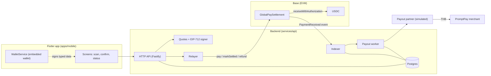
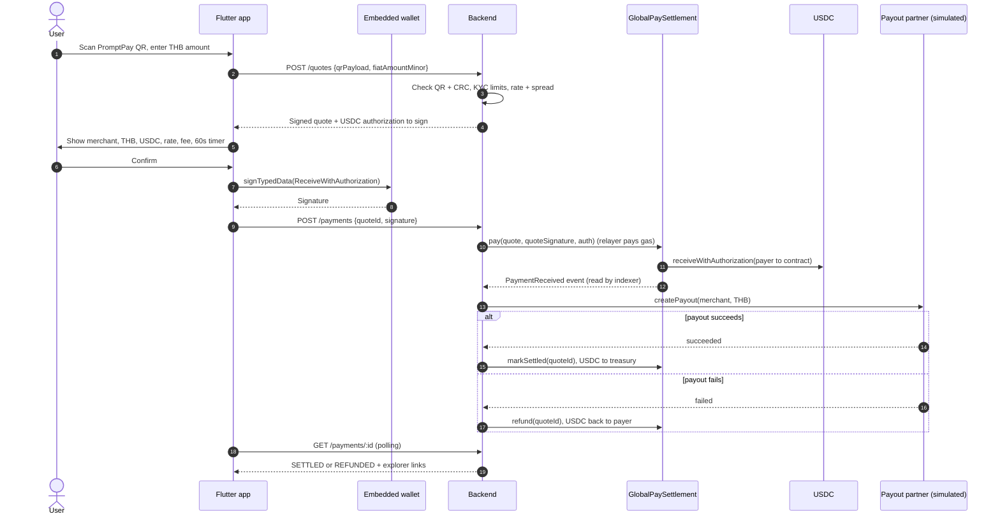

# Architecture

This document describes the architecture of the GlobalPay **testnet demo**. A user scans a Thai PromptPay QR in the Flutter app, pays with USDC on Base Sepolia, and sees a simulated baht payout settle or refund.

## Goals and non-goals

**Goals**
- Prove the full payment loop end to end: scan, quote, sign, pay on-chain, pay out, settle or refund.
- Users never need ETH for gas, and never hand custody of their funds to GlobalPay before they pay.
- Every external partner sits behind an interface, so real partners can replace the simulated ones without touching core logic.

**Non-goals for the demo**
- Real money, mainnet, or real partner integrations (exchange, e-money, PromptPay payout, KYC).
- Card issuing, USDT support, or countries other than Thailand.

## System overview



## Components

### Mobile app: `apps/mobile` (Flutter)

| Layer | Folder | Responsibility |
|---|---|---|
| App shell | `lib/app/` | `MaterialApp.router`, routes (`go_router`), theme |
| Core | `lib/core/` | Config from `--dart-define`, Riverpod providers, shared widgets, errors |
| Domain | `lib/domain/` | Pure Dart models (money, quote, payment, PromptPay QR) and the PromptPay parser |
| Data | `lib/data/` | Repositories over the API client generated from the OpenAPI spec (`lib/data/api/generated/`), plus the saved session |
| Services | `lib/services/wallet/` | `WalletService` interface; `DevWalletService` (local key, development only) and `PrivyWalletService` (embedded wallet) |
| Features | `lib/features/` | One folder per screen group: auth, kyc, home, receive, scan, pay, history |

### Backend: `services/api` (TypeScript, Node 22)

This is a ports-and-adapters design. Core logic depends only on `domain/` and `ports/`. Anything that talks to the outside world lives in `adapters/`.

| Folder | Responsibility |
|---|---|
| `src/domain/` | Types and rules with no I/O: money in integer minor units, pricing, quotes, the payment state machine, users and KYC limits |
| `src/ports/` | Interfaces to the outside world: repositories, `KycProvider`, `RateProvider`, `PayoutProvider`, `SettlementGateway`, `QuoteSigner` |
| `src/adapters/` | Implementations of the ports: Prisma repositories, mock KYC, Coinbase public rate feed (or a fixed rate), simulated PromptPay payout, viem chain gateway and quote signer |
| `src/lib/promptpay/` | EMVCo PromptPay parser and builder (pure functions, tested against `packages/fixtures`) |
| `src/lib/typed-data.ts` | EIP-712 types shared with the contracts: `Quote` and USDC `ReceiveWithAuthorization` |
| `src/modules/` | HTTP features. Each has `routes.ts` (validation + HTTP) and `service.ts` (use case). Modules: `auth`, `kyc`, `quotes`, `payments`, `account` |
| `src/shared/` | Errors, zod schemas, request-user helper |
| `src/config/` | Validated environment configuration |
| `src/workers/` | Background loops: `indexer` (reads chain events) and `payout-worker` (pays out, then settles or refunds) |
| `src/container.ts` | Composition root: builds adapters from config and wires them into services and workers |
| `src/app.ts`, `src/main.ts` | Fastify app factory and process entry point |
| `prisma/` | Database schema (Postgres) |

### Smart contract: `contracts/` (Solidity, Foundry)

- **`GlobalPaySettlement`:** receives USDC against backend-signed quotes and tracks each payment until it's settled or refunded. The interface is in `src/interfaces/IGlobalPaySettlement.sol`. The contract isn't upgradeable ([ADR 0006](adr/0006-immutable-settlement-contract.md)).
- **`IERC3009`:** the part of USDC's interface used for gasless, signature-based transfers.

### Shared test data: `packages/fixtures`

PromptPay QR test vectors, used by both the Dart and TypeScript parsers so they behave identically.

## Payment flow



## State machines

**On-chain, per `quoteId`** (in `GlobalPaySettlement`):

```
None ──pay──▶ Paid ──markSettled──▶ Settled
                │
                └────refund───────▶ Refunded
```

**Off-chain payment** (`src/domain/payment.ts`, Prisma enum `PaymentStatus`):

```
SUBMITTED ──▶ PAID ──▶ PAYOUT_PENDING ──▶ SETTLED
    │                        │
    └──▶ FAILED              └──▶ REFUNDED
```

- `SUBMITTED`: the relayer has sent `pay()` (or is confirming whether it was sent).
- `FAILED`: no funds moved. Either the contract would reject it (found by simulation, so nothing was sent), the `pay()` transaction reverted, or it didn't land before the quote expired.
- `PAID`: the indexer saw `PaymentReceived` at the confirmation depth.
- `PAYOUT_PENDING`: the payout partner was asked to pay the merchant.
- `SETTLED` / `REFUNDED`: the `markSettled` / `refund` transaction is in a block.

On-chain events are the source of truth, and every step can be repeated safely ([ADR 0007](adr/0007-chain-is-the-source-of-truth.md)).

## Settlement loop

Three parts of the backend move a payment along. Each pass is safe to repeat after a crash.

| Part | Where | What it does |
|---|---|---|
| **Relayer** | `src/adapters/chain/relayer.ts` | Sends `pay`, `markSettled` and `refund` from the operator key. It simulates each call first: a revert becomes `TransactionRejectedError`, decoded to the contract's error name (e.g. `ERC20InsufficientBalance`), and nothing is sent. Calls are queued with a tracked nonce, re-read from the node when wrong. It signs locally, so after a timeout it can resend the same bytes safely. |
| **Indexer** | `src/workers/indexer.ts` | Every `INDEXER_POLL_MS`, reads `PaymentReceived` from its saved block cursor (`INDEXER_START_BLOCK` the first time) up to `INDEXER_CONFIRMATIONS` behind the head, in chunks of 2,000 blocks, and moves payments SUBMITTED → PAID. It also tracks a payment someone else relayed, since `pay()` is permissionless. It then reconciles SUBMITTED payments: a reverted `pay()` becomes FAILED, and so does one that didn't land within a minute after its quote expired (checked against `paymentOf`). |
| **Payout worker** | `src/workers/payout-worker.ts` | Every `PAYOUT_POLL_MS`: PAID → creates the payout → PAYOUT_PENDING → asks the partner, then polls it. On success it calls `markSettled`; on failure, `refund`, saving the partner's reason. Before sending, it reads `paymentOf` and records a result that's already on-chain instead of sending again. |

`POST /payments` returns `202` with status SUBMITTED right after sending. The app polls `GET /payments/:id` until SETTLED, REFUNDED or FAILED. Each response links the transactions on `EXPLORER_URL`.

The simulated partner (`SimulatedPromptPayProvider`) keeps no state:
- its reference encodes the payment ID and start time;
- a payout resolves after `PAYOUT_DELAY_MS`;
- whether it fails depends only on the payment ID and `PAYOUT_FAILURE_RATE` (1 fails every payout).

## Signatures

Two signatures authorise every payment.

**1. Quote, signed by the backend's quote-signer key** (EIP-712, verified by the contract):

```
Domain: { name: "GlobalPay Settlement", version: "1", chainId, verifyingContract }

Quote(
  bytes32 quoteId,
  address payer,
  address token,
  uint256 tokenAmount,
  bytes3  fiatCurrency,
  uint256 fiatAmount,
  bytes32 merchantRefHash,
  uint64  expiresAt
)
```

**2. USDC `ReceiveWithAuthorization`, signed by the user's wallet** (EIP-3009):

```
ReceiveWithAuthorization(from = payer, to = settlement contract, value = tokenAmount,
                         validAfter, validBefore = expiresAt, nonce = quoteId)
```

- `nonce = quoteId` ties the user's authorisation to exactly one quote.
- `receiveWithAuthorization` requires the caller to be the recipient (the contract), so nobody can front-run the transfer.
- A quote is valid while `block.timestamp < expiresAt`, the same rule USDC applies to `validBefore`. With `validBefore = expiresAt`, both signatures expire at the same second.
- The USDC EIP-712 domain (`name`, `version`) is read from the chain, never hardcoded. It differs between Base Sepolia and Base mainnet.
- `POST /quotes` returns both: the signed quote, and the `ReceiveWithAuthorization` as complete `eth_signTypedData_v4` data for the wallet to sign unchanged.
- The backend's encoding is pinned by a test: its digest and signature must equal what `GlobalPaySettlement.hashQuote` produces on anvil.

## Sign-in

Sign-In with Ethereum (EIP-4361), then a bearer token:

1. `POST /auth/nonce {address}`: the server stores a one-time nonce for that address (5 minutes) and returns the full message to sign.
2. The wallet signs the message (`personal_sign`).
3. `POST /auth/verify {message, signature}`: the server checks, in order:
   1. the message's domain (`SIWE_DOMAIN`), URI, chain ID and expiry;
   2. the signature;
   3. the nonce, consumed atomically: it must be unused, unexpired, and issued to the same address.
4. On success the server creates the user on first sign-in and returns a JWT (HS256, `JWT_TTL_SECONDS`, 24 hours by default) with the user ID and wallet.

An auth hook checks the `Authorization: Bearer` header on every request. Protected routes reject anonymous requests with `401`.

The signature check is offline, which covers ordinary wallets (EOAs), including embedded wallets. Smart-contract wallets would need an on-chain ERC-1271 check.

## Quotes and pricing

`POST /quotes {payer, qrPayload, fiatAmountMinor?}` runs these steps:

1. **Parse the QR**, with the checks and error codes in `packages/fixtures`. With `MERCHANT_QR_ONLY`, personal QRs are refused.
2. **Amount:** a dynamic QR fixes it; for a static QR the app sends `fiatAmountMinor`.
3. **Payer:** must be the signed-in wallet.
4. **Limits:** KYC must be approved, and the amount must fit the tier's per-payment limit and the rolling 24-hour limit. Failed and refunded payments don't count toward the 24 hours. Iteration 4 checks again when the payment is submitted.
5. **Price:** the mid-market rate, plus the spread:

   ```
   tokenAmount = ceil( fiat / rate × (1 + SPREAD_BPS / 10000) )
   ```

   It's exact integer maths with one division, rounded up, so GlobalPay never receives less than it pays the merchant. `SPREAD_BPS` defaults to 100 (1%). The demo rate comes from Coinbase's public feed (cached for 30 seconds); production uses the exchange partner's quote.
6. **Sign and store:** a random `quoteId`, and an expiry `QUOTE_TTL_SECONDS` ahead (60 s by default) on a whole second. `merchantRefHash` is `keccak256("promptpay:<targetType>:<targetId>")`. It names the payee, while the raw QR stays in the database for the payout.

## Keys and roles

| Key / role | Held by | Can | Cannot |
|---|---|---|---|
| Admin (`DEFAULT_ADMIN_ROLE`) | Deployer on testnet; multisig in production | Grant and revoke roles, set treasury, allowlist tokens, unpause | Move a payment directly |
| Quote signer (`QUOTE_SIGNER_ROLE`) | Backend (KMS in production) | Sign quotes | Move funds: every quote still needs the user's USDC authorisation |
| Operator (`OPERATOR_ROLE`) | Backend relayer | Call `markSettled` and `refund`; pay gas | Send USDC anywhere except the treasury or back to the payer |
| Pauser (`PAUSER_ROLE`) | Operations | Pause new payments | Unpause, or move funds |
| Treasury | Company wallet (multisig in production) | Receive settled USDC | — |
| User wallet | Embedded wallet provider, controlled by the user | Authorise exactly one payment per quote | — |

`pay()` is permissionless. The relayer usually submits it, but anyone holding a valid quote and user signature could. This leaves room to support external wallets later.

## Data model (Prisma)

| Model | Purpose |
|---|---|
| `User` | Wallet address (lowercase), created at first sign-in |
| `KycRecord` | Provider, tier, status |
| `SiweNonce` | One-time nonces for Sign-In with Ethereum |
| `Quote` | Signed quote, raw QR payload, rate, spread, expiry |
| `Payment` | Lifecycle status, transaction hashes (`pay`, `settle`, `refund`), and why it failed or was refunded |
| `Payout` | Partner reference, status, attempts, failure reason |
| `IndexerCursor` | Last processed block per contract and chain |

All money is stored as integers in minor units: USDC base units (6 decimals) and THB satang (2 decimals). Exchange rates are fixed-point integers scaled by 1e8 (`rateE8`).

## HTTP API

| Method | Path | Purpose | Iteration |
|---|---|---|---|
| GET | `/health` | Liveness | 1 ✅ |
| POST | `/auth/nonce` | Get a Sign-In with Ethereum (SIWE) nonce and message | 3 ✅ |
| POST | `/auth/verify` | Verify a SIWE signature and return a JWT | 3 ✅ |
| POST | `/kyc/start` | Start KYC (mock) | 3 ✅ |
| GET | `/kyc/status` | KYC tier, status and limits | 3 ✅ |
| POST | `/quotes` | Quote a PromptPay QR payment | 3 ✅ |
| POST | `/payments` | Submit a signed authorisation; returns 202 SUBMITTED | 4 ✅ |
| GET | `/payments/:id` | Payment status and transaction links | 4 ✅ |
| GET | `/me/balance` | USDC balance, read from the chain | 4 ✅ |
| GET | `/me/payments` | Payment history, newest first | 4 ✅ |
| GET | `/docs`, `/docs/json` | OpenAPI docs and spec | 3 ✅ |

Each route declares zod schemas. The same schemas validate requests, shape responses, and generate the OpenAPI spec. Every operation has an `operationId`, and the main schemas have names (`QuoteResponse`, `Payment`, …), so generated clients get readable methods and classes.

The spec is committed at [`packages/openapi/openapi.json`](../packages/openapi/openapi.json) (`npm run openapi` rewrites it). A backend test fails if it differs from the routes. The app's Dart client is generated from that file with `swagger_parser` (see [apps/mobile/README.md](../apps/mobile/README.md)).

Errors are `{ "error": "<code>", "message": "…" }` with a stable code, for example `invalid_qr` (422), `kyc_required` (403), `daily_limit_exceeded` (422) or `rate_unavailable` (503).

## Security and compliance controls in the design

- **No custody before payment:** funds stay in the user's own wallet until they authorise a specific quote.
- **Short quotes:** quotes expire after 60 seconds (`QUOTE_TTL_SECONDS`). The contract and USDC both enforce the expiry.
- **No replay:** each `quoteId` can be used once, enforced by both the contract state and the USDC nonce.
- **Merchant-only QRs:** a policy flag (`MERCHANT_QR_ONLY`), on in production, stops payments to personal accounts.
- **KYC-based limits:** per-payment and per-day limits by tier (`src/domain/user.ts`).
- **Emergency stop:** `pause()` stops new payments. Settling and refunding still work, so in-flight funds can always be resolved. Only the admin can unpause ([ADR 0006](adr/0006-immutable-settlement-contract.md)).
- **Received-amount check:** `pay` reverts with `UnexpectedTokenTransfer` unless the contract received exactly the quoted amount.
- **Exact money maths:** amounts are integers everywhere and never floating point, and token amounts round up. Even the rate feed's decimal strings are parsed without floats.
- **No sign-in replay:** each sign-in nonce is bound to one address and consumed atomically, after the signature is checked, so nobody can use up another wallet's nonce.
- **Testnet keys only:** keys live in a gitignored `.env` and are never committed.

## Configuration

- Backend: `services/api/.env.example`.
- Contracts: `contracts/.env.example`.
- Mobile app: `--dart-define` values (`API_BASE_URL`, `CHAIN_ID`, `EXPLORER_URL`), so the app ships no secrets.

Design decisions are recorded in [`docs/adr/`](adr/).
