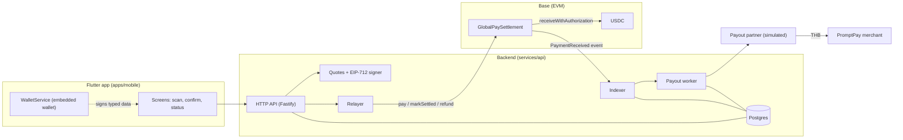
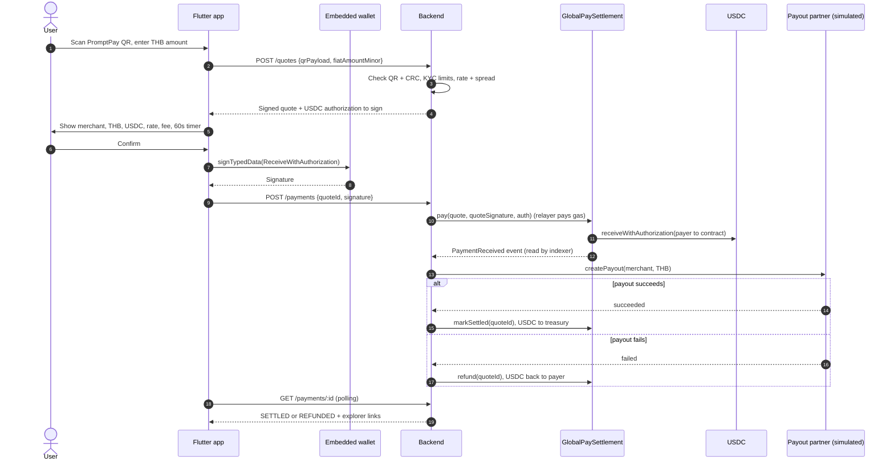

# Architecture

This document describes the architecture of the GlobalPay **testnet demo**. A user scans a Thai PromptPay QR in the Flutter app, pays with USDC on Base Sepolia, and sees a simulated baht payout settle or refund.

## Goals and non-goals

**Goals**
- Prove the full payment loop end to end: scan, quote, sign, pay on-chain, pay out, settle or refund.
- Users never need ETH for gas, and never hand custody of their funds to GlobalPay before they pay.
- Every external partner sits behind an interface, so real partners can replace the simulated ones without touching core logic.

**Non-goals for the demo**
- Real money, mainnet, or real partner integrations (exchange, e-money, PromptPay payout, KYC).
- Card issuing, USDT support, or countries other than Thailand.

## System overview



## Components

### Mobile app: `apps/mobile` (Flutter)

| Layer | Folder | Responsibility |
|---|---|---|
| App shell | `lib/app/` | `MaterialApp.router`, routes (`go_router`), theme |
| Core | `lib/core/` | Config from `--dart-define`, Riverpod providers, shared widgets, errors |
| Domain | `lib/domain/` | Pure Dart models (money, quote, payment, PromptPay QR) and the PromptPay parser |
| Data | `lib/data/` | HTTP client (`dio`) and repositories. The OpenAPI-generated client goes in `lib/data/api/generated/`. |
| Services | `lib/services/wallet/` | `WalletService` interface; `DevWalletService` (local key, development only) and `PrivyWalletService` (embedded wallet) |
| Features | `lib/features/` | One folder per screen group: auth, kyc, home, receive, scan, pay, history |

### Backend: `services/api` (TypeScript, Node 22)

This is a ports-and-adapters design. Core logic depends only on `domain/` and `ports/`. Anything that talks to the outside world lives in `adapters/`.

| Folder | Responsibility |
|---|---|
| `src/domain/` | Types and rules with no I/O: money in integer minor units, quotes, the payment state machine, users and KYC limits |
| `src/ports/` | Interfaces to the outside world: `KycProvider`, `RateProvider`, `PayoutProvider`, `SettlementGateway`, `QuoteSigner` |
| `src/adapters/` | Implementations of the ports: mock KYC, public rate feed, simulated PromptPay payout, viem chain gateway and quote signer |
| `src/lib/promptpay/` | EMVCo PromptPay parser and builder (pure functions, tested against `packages/fixtures`) |
| `src/modules/` | HTTP features. Each has `routes.ts` (validation + HTTP) and `service.ts` (use case). Modules: `auth`, `kyc`, `quotes`, `payments`, `account` |
| `src/shared/` | Errors, zod schemas, request-user helper |
| `src/config/` | Validated environment configuration |
| `src/workers/` | Background loops: `indexer` (reads chain events) and `payout-worker` (pays out, then settles or refunds) |
| `src/container.ts` | Composition root: builds adapters from config and wires them into services and workers |
| `src/app.ts`, `src/main.ts` | Fastify app factory and process entry point |
| `prisma/` | Database schema (Postgres) |

### Smart contract: `contracts/` (Solidity, Foundry)

- **`GlobalPaySettlement`:** receives USDC against backend-signed quotes and tracks each payment until it's settled or refunded. The interface is in `src/interfaces/IGlobalPaySettlement.sol`.
- **`IERC3009`:** the part of USDC's interface used for gasless, signature-based transfers.

### Shared test data: `packages/fixtures`

PromptPay QR test vectors, used by both the Dart and TypeScript parsers so they behave identically.

## Payment flow



## State machines

**On-chain, per `quoteId`** (in `GlobalPaySettlement`):

```
None ──pay──▶ Paid ──markSettled──▶ Settled
                │
                └────refund───────▶ Refunded
```

**Off-chain payment** (`src/domain/payment.ts`, Prisma enum `PaymentStatus`):

```
SUBMITTED ──▶ PAID ──▶ PAYOUT_PENDING ──▶ SETTLED
    │                        │
    └──▶ FAILED              └──▶ REFUNDED
```

- `SUBMITTED`: the relayer has sent `pay()`.
- `FAILED`: the `pay()` transaction reverted, for example because the quote expired.
- `PAID`: the indexer saw `PaymentReceived`.
- `PAYOUT_PENDING`: the payout partner was called.
- `SETTLED` / `REFUNDED`: the matching on-chain transaction confirmed.

On-chain events are the source of truth. Processing an event the indexer has already seen has no effect.

## Signatures

Two signatures authorise every payment.

**1. Quote, signed by the backend's quote-signer key** (EIP-712, verified by the contract):

```
Domain: { name: "GlobalPay Settlement", version: "1", chainId, verifyingContract }

Quote(
  bytes32 quoteId,
  address payer,
  address token,
  uint256 tokenAmount,
  bytes3  fiatCurrency,
  uint256 fiatAmount,
  bytes32 merchantRefHash,
  uint64  expiresAt
)
```

**2. USDC `ReceiveWithAuthorization`, signed by the user's wallet** (EIP-3009):

```
ReceiveWithAuthorization(from = payer, to = settlement contract, value = tokenAmount,
                         validAfter, validBefore = expiresAt, nonce = quoteId)
```

- `nonce = quoteId` ties the user's authorisation to exactly one quote.
- `receiveWithAuthorization` requires the caller to be the recipient (the contract), so nobody can front-run the transfer.
- The USDC EIP-712 domain (`name`, `version`) is read from the chain, never hardcoded. It differs between Base Sepolia and Base mainnet.

## Keys and roles

| Key / role | Held by | Can | Cannot |
|---|---|---|---|
| Admin (`DEFAULT_ADMIN_ROLE`) | Deployer on testnet; multisig in production | Grant and revoke roles, set treasury, allowlist tokens | Move a payment directly |
| Quote signer (`QUOTE_SIGNER_ROLE`) | Backend (KMS in production) | Sign quotes | Move funds: every quote still needs the user's USDC authorisation |
| Operator (`OPERATOR_ROLE`) | Backend relayer | Call `markSettled` and `refund`; pay gas | Send USDC anywhere except the treasury or back to the payer |
| Pauser (`PAUSER_ROLE`) | Operations | Pause new payments | Move funds |
| Treasury | Company wallet (multisig in production) | Receive settled USDC | — |
| User wallet | Embedded wallet provider, controlled by the user | Authorise exactly one payment per quote | — |

`pay()` is permissionless. The relayer usually submits it, but anyone holding a valid quote and user signature could. This leaves room to support external wallets later.

## Data model (Prisma)

| Model | Purpose |
|---|---|
| `User` | Wallet address (lowercase), created at first sign-in |
| `KycRecord` | Provider, tier, status |
| `SiweNonce` | One-time nonces for Sign-In with Ethereum |
| `Quote` | Signed quote, raw QR payload, rate, spread, expiry |
| `Payment` | Lifecycle status and transaction hashes (`pay`, `settle`, `refund`) |
| `Payout` | Partner reference, status, attempts, failure reason |
| `IndexerCursor` | Last processed block per contract and chain |

All money is stored as integers in minor units: USDC base units (6 decimals) and THB satang (2 decimals). Exchange rates are fixed-point integers scaled by 1e8 (`rateE8`).

## HTTP API (planned)

| Method | Path | Purpose | Iteration |
|---|---|---|---|
| GET | `/health` | Liveness | 1 |
| POST | `/auth/nonce` | Get a Sign-In with Ethereum (SIWE) nonce | 3 |
| POST | `/auth/verify` | Verify a SIWE signature and return a JWT | 3 |
| POST | `/kyc/start` | Start KYC (mock) | 3 |
| GET | `/kyc/status` | KYC tier and status | 3 |
| POST | `/quotes` | Quote a PromptPay QR payment | 3 |
| POST | `/payments` | Submit a signed authorisation | 4 |
| GET | `/payments/:id` | Payment status | 4 |
| GET | `/me/balance` | USDC balance | 4 |
| GET | `/me/payments` | Payment history | 4 |

An OpenAPI spec is generated from the route schemas, and the Dart client is generated from that spec.

## Security and compliance controls in the design

- **No custody before payment:** funds stay in the user's own wallet until they authorise a specific quote.
- **Short quotes:** quotes expire after 60 seconds (`QUOTE_TTL_SECONDS`). The contract and USDC both enforce the expiry.
- **No replay:** each `quoteId` can be used once, enforced by both the contract state and the USDC nonce.
- **Merchant-only QRs:** a policy flag (`MERCHANT_QR_ONLY`), on in production, stops payments to personal accounts.
- **KYC-based limits:** per-payment and per-day limits by tier (`src/domain/user.ts`).
- **Emergency stop:** `pause()` stops new payments. Settling and refunding still work, so in-flight funds can always be resolved.
- **Exact money maths:** amounts are integers everywhere and never floating point.
- **Testnet keys only:** keys live in a gitignored `.env` and are never committed.

## Configuration

- Backend: `services/api/.env.example`.
- Contracts: `contracts/.env.example`.
- Mobile app: `--dart-define` values (`API_BASE_URL`, `CHAIN_ID`, `EXPLORER_URL`), so the app ships no secrets.

Design decisions are recorded in [`docs/adr/`](adr/).
