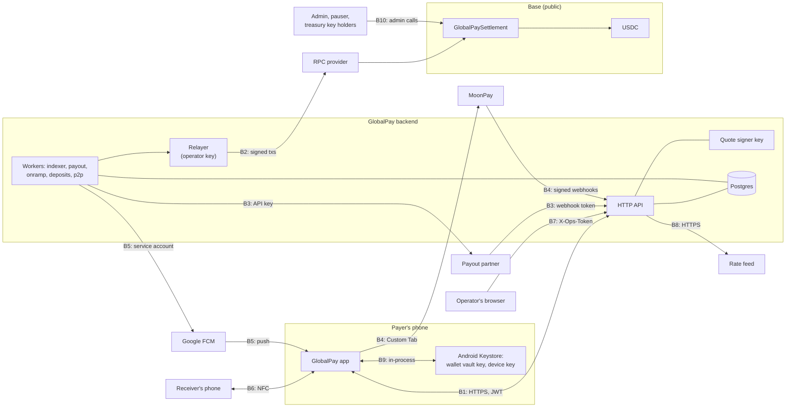

# Security: threat model

This is the threat model for GlobalPay as built at iteration 9 (commit `4f364e3`): a testnet product on Base Sepolia with simulated or sandbox partners. It lists what we protect, from whom, where the trust boundaries are, and, per component, each threat with the control that exists today or the gap that remains.

Related documents:
- [Key rotation runbook](runbooks/key-rotation.md): how to replace every secret, and what to do when one leaks.
- [Launch checklist](launch-checklist.md): what must be true before real money moves.
- [Architecture](architecture.md) and the [decision records](adr/).

**How to read the tables.** Each threat has an ID, a STRIDE letter (**S**poofing, **T**ampering, **R**epudiation, **I**nformation disclosure, **D**enial of service, **E**levation of privilege), what exists today with a file or ADR reference, and a status:

- **Done:** the control exists (and is tested, where it's code).
- **Partial:** a control exists but leaves a known hole.
- **Gap:** nothing yet. The row says what to build, who owns it and when.

Owners are workstreams: **App** (`apps/mobile`), **Backend** (`services/api`), **Contracts** (`contracts/`), **Ops** (running the service), **Owner** (the project owner: partner accounts, legal, business). "When" is an iteration from the [roadmap](roadmap.md): **It. 10** (production hardening), **It. 11** (embedded wallet), **Launch** (the [launch checklist](launch-checklist.md), before real money), or **Later** (after launch).

Update this document whenever an ADR changes a trust boundary, a new partner is added, or a gap is closed.

## 1. Security goals

These must hold at all times. Every threat below is a way to break one of them.

1. **No funds move without the user's signature** over that exact amount, recipient and expiry (EIP-3009, [ADR 0002](adr/0002-usdc-eip3009-gasless.md)).
2. **Funds in the contract go only to the treasury or back to the payer** ([`GlobalPaySettlement.sol`](../contracts/src/GlobalPaySettlement.sol)).
3. **A merchant is paid at most once per payment, and the user is refunded only when the payout definitely failed** ([ADR 0008](adr/0008-payout-outcomes-and-reconciliation.md)).
4. **The chain decides**: nothing is shown as paid, settled or added until it's confirmed on-chain ([ADR 0007](adr/0007-chain-is-the-source-of-truth.md), [ADR 0009](adr/0009-add-money-proved-on-chain.md)).
5. **No custody before payment**: GlobalPay never holds a user's key or funds before they authorise a specific payment ([ADR 0003](adr/0003-embedded-non-custodial-wallet.md)).
6. **Personal data is collected only when needed and is not exposed** (Thailand's PDPA, see the [launch checklist](launch-checklist.md#7-data-protection-pdpa)).

## 2. Assets

| Asset | Where it lives | If lost or misused |
|---|---|---|
| **User USDC in wallets** | User's wallet. Today the dev wallet: a key sealed by a fingerprint-locked Keystore key ([`KeyVault.kt`](../apps/mobile/android/app/src/main/kotlin/com/globalpay/globalpay/KeyVault.kt)); iteration 11 moves to Privy | The user loses their balance |
| **USDC in the settlement contract** | `GlobalPaySettlement`, between `pay` and `markSettled`/`refund` (seconds to minutes per payment) | In-flight payments are lost or misrouted |
| **Treasury USDC** | The treasury address set in the contract (`setTreasury`); a testnet key in `contracts/.env` today, a multisig in production | Company revenue and float top-up money is lost |
| **Payout float (THB)** | Pre-funded balance at the payout partner (Xendit sandbox today) | Whoever holds the partner key can pay anyone from it. In production, the most directly stealable money |
| **Relayer ETH** | The relayer address (gas for every payment) | Payments stop settling until it's refilled |
| **Contract keys** | Admin (`DEFAULT_ADMIN_ROLE`), pauser, quote signer, relayer/operator, treasury | See the [key inventory](runbooks/key-rotation.md#inventory) for each key's blast radius |
| **Backend secrets** | `JWT_SECRET`, `OPS_API_TOKEN`, `DATABASE_URL`, RPC URL (may hold an API key) in the backend's env file | Forged sessions, operator actions, data access |
| **Partner credentials** | `XENDIT_SECRET_KEY`, `XENDIT_CALLBACK_TOKEN`, `MOONPAY_SECRET_KEY`, `MOONPAY_WEBHOOK_KEY`, the FCM service-account file (`FCM_SERVICE_ACCOUNT_FILE`) | Payouts from our float, signed widget URLs under our account, push messages to our users |
| **App signing key** | Not set up: release builds are signed with the debug key ([`build.gradle.kts`](../apps/mobile/android/app/build.gradle.kts)) | Anyone could ship an "update" of the app |
| **Device keys** | P-256 key per phone in the Android Keystore, StrongBox when available ([`TapCard.kt`](../apps/mobile/android/app/src/main/kotlin/com/globalpay/globalpay/TapCard.kt)) | A phone could be impersonated in a tap (identification only) |
| **Personal data** | Postgres: wallet addresses, display names, KYC records (mock today), quotes with the raw QR (for personal QRs: a mobile number or national ID), payment and deposit history, device public keys, FCM tokens. Logs: client IP addresses. Partners: card data (MoonPay), ID documents (future KYC vendor) | Privacy harm, PDPA breach, fraud targeting |
| **Records** | `Payment`, `Payout`, `PayoutEvent`, `OpsAction`, `OnrampOrder`, `Deposit` in Postgres ([`schema.prisma`](../services/api/prisma/schema.prisma)) | Wrong payouts, no audit trail |
| **Availability** | One API process with its workers; the Base sequencer | Users can't pay; in-flight funds wait in the contract |

## 3. Actors

| Actor | Trust | What they can reach |
|---|---|---|
| **Users** (payers, tap-to-pay receivers) | Authenticated by wallet signature; may make mistakes | Their own data through the API; their own wallet |
| **Merchants** | Not users of the app; their QR is our input | Nothing directly. A fraudulent merchant (a mule account behind a QR) is the main AML risk |
| **Fraudulent users** | Pass KYC, then abuse the product | Structuring under limits, mule cash-out, fake names in tap to pay, stolen cards at the onramp |
| **External attackers** | None | Public API, webhooks, `/ops` login, malicious Wi-Fi, fake QR stickers, NFC relays, stolen or malware-infected phones |
| **Operators** | Hold `OPS_API_TOKEN` | Resolve UNKNOWN payouts (mark paid, approve refund) through `/ops` |
| **Engineers and key holders** | Server and env-file access; contract keys | Everything the keys allow |
| **Payout partner** (Xendit sandbox; Krungsri or a licensed partner later) | Semi-trusted: we act on their answers only after re-fetching | Holds our THB float; reports payout outcomes |
| **Onramp partner** (MoonPay) | Semi-trusted: delivery is proved on-chain | Card payments; delivers USDC |
| **Infrastructure partners** | Semi-trusted | RPC provider (sees and answers every chain read), Google FCM (delivers push), Coinbase (rate feed, Base sequencer), Circle (USDC issuer: can freeze addresses or pause USDC) |
| **Supply chain** | Pinned versions | npm packages (exact versions, `package-lock.json`), Dart packages (`pubspec.lock`), Foundry libraries (pinned submodules) |

## 4. Trust boundaries and data flows

| Boundary | Between | What crosses it | Protection today |
|---|---|---|---|
| **B1** | App ↔ API | Sign-in, quotes, signatures, history, profile, devices | HTTPS (plain HTTP only in debug builds, [`src/debug/AndroidManifest.xml`](../apps/mobile/android/app/src/debug/AndroidManifest.xml)); SIWE then an HS256 JWT ([`tokens.ts`](../services/api/src/modules/auth/tokens.ts)); zod validation on every route |
| **B2** | Backend ↔ chain | `pay`, `markSettled`, `refund`, `transferWithAuthorization`; event and receipt reads | Locally signed transactions ([`relayer.ts`](../services/api/src/adapters/chain/relayer.ts)); the contract enforces roles and signatures; reads trust one RPC provider |
| **B3** | Backend ↔ payout partner | Payout creates and lookups (merchant account, amount); webhooks back | Basic auth with the secret key, `Idempotency-key`; webhook token compared in constant time, then the payout is re-fetched ([`xendit-provider.ts`](../services/api/src/adapters/payouts/xendit-provider.ts)) |
| **B4** | App/backend ↔ MoonPay | Signed widget URL (wallet address, amount); card details (MoonPay only); webhooks back | HMAC-signed URL; Custom Tab, never a WebView; `Moonpay-Signature-V2` over the raw body with a five-minute window ([`moonpay-provider.ts`](../services/api/src/adapters/onramp/moonpay-provider.ts)) |
| **B5** | Backend ↔ FCM ↔ phone | A generic title and a request ID | Service-account JWT for an OAuth token ([`fcm-push-sender.ts`](../services/api/src/adapters/push/fcm-push-sender.ts)); no amounts or names in the message |
| **B6** | Phone ↔ phone | Device ID and a P-256 signature over a one-time challenge | Answers only while armed and unlocked; one-time challenge checked by the backend ([ADR 0010](adr/0010-tap-to-pay.md)) |
| **B7** | Operator ↔ `/ops` | Exceptions, merchant names, amounts; mark-paid and refund actions | One shared token in `X-Ops-Token`, constant-time compare, strict CSP ([`ops/routes.ts`](../services/api/src/modules/ops/routes.ts)) |
| **B8** | Backend ↔ rate feed | USDC/THB rate | HTTPS, exact decimal parsing, 30-second cache ([`public-feed-rate-provider.ts`](../services/api/src/adapters/rates/public-feed-rate-provider.ts)) |
| **B9** | App ↔ Keystore | Wallet key sealed and unsealed; tap signatures | AES-GCM key needing a strong biometric for every use, through `BiometricPrompt` with a `CryptoObject` ([`KeyVault.kt`](../apps/mobile/android/app/src/main/kotlin/com/globalpay/globalpay/KeyVault.kt)) |
| **B10** | Key holders ↔ contract | Role grants, treasury, token allowlist, pause/unpause | `AccessControl` roles; only the admin can unpause ([ADR 0006](adr/0006-immutable-settlement-contract.md)) |

## 5. Threats by component

### 5.1 Mobile app (`apps/mobile`)

| ID | | Threat | Today | Status |
|---|---|---|---|---|
| APP-1 | S | Someone holding an unlocked phone signs a payment | Every signature unseals the wallet key through a strong biometric (`KeyVault.kt`); the confirm and approve screens show amount and payee | **Partial.** Phones without strong biometrics fall back to `flutter_secure_storage` with no per-use check ([`dev_wallet_service.dart`](../apps/mobile/lib/services/wallet/dev_wallet_service.dart)). Replaced by the Privy wallet's own auth: **App, It. 11** |
| APP-2 | I | The wallet key is extracted (root, malware, backup) | Sealed by a hardware-backed Keystore key; enrolling a new fingerprint invalidates it | **Partial.** `android:allowBackup` isn't set (so it defaults to on), and there's no root or Play Integrity check. Turn backup off and add an integrity check: **App, It. 10** |
| APP-3 | T | A release build ships with the dev wallet, a `DEV_WALLET_PRIVATE_KEY` dart-define, plain HTTP or debug signing | Plain HTTP is allowed only in the debug manifest; the app ships no secrets by design ([`app_config.dart`](../apps/mobile/lib/core/config/app_config.dart)) | **Gap.** Release builds are signed with the debug key, `API_BASE_URL` defaults to `http://10.0.2.2:3000`, and the dev wallet is the only wallet. Roadmap iteration 10, item 1: **App, It. 10** |
| APP-4 | T | A fake QR (a sticker over the shop's QR, or a personal account dressed up as a shop) takes the payment | QR CRC and field checks shared with the backend ([`packages/fixtures`](../packages/fixtures)); `MERCHANT_QR_ONLY` refuses personal QRs; the confirm screen shows the merchant name from the QR | **Partial.** The name in a QR is whatever its creator typed. Show the payee name returned by the payout partner's name inquiry before signing: **Backend + App, Launch**. `MERCHANT_QR_ONLY` is off by default and production doesn't force it on ([`env.ts`](../services/api/src/config/env.ts)): **Backend, It. 10** |
| APP-5 | S | Man in the middle on the API (hostile Wi-Fi, user-installed CA) | HTTPS; Android doesn't trust user-installed CAs for apps targeting API 24+ | **Partial.** No certificate pinning. Consider it once the production domain is fixed: **App, Later** |
| APP-6 | I | Card details are read by the app during Add money | Checkout opens in a Custom Tab, never a WebView ([ADR 0009](adr/0009-add-money-proved-on-chain.md)) | **Done** |
| APP-7 | I | The session token is stolen from storage | Kept in `flutter_secure_storage` ([`session_store.dart`](../apps/mobile/lib/data/session_store.dart)); expires with the JWT | **Done** for the testnet; see API-1 for server-side revocation |
| APP-8 | D | Changed fingerprints lock the user out of the dev wallet | Accepted for a testnet wallet ([ADR 0010](adr/0010-tap-to-pay.md)) | **Gap** for real money: the Privy wallet brings recovery: **App, It. 11** |
| APP-9 | R | A user denies making a payment | The user's EIP-3009 signature and the on-chain transaction are the evidence | **Done.** A dispute flow ("merchant not paid") is on the product backlog: **Later** |

### 5.2 Backend API (`services/api`)

| ID | | Threat | Today | Status |
|---|---|---|---|---|
| API-1 | S | Forged or stolen session tokens | SIWE checks domain, URI, chain, expiry, signature and a one-time nonce bound to the address and consumed atomically ([`auth/service.ts`](../services/api/src/modules/auth/service.ts)); HS256 JWT with issuer, audience and a 24-hour TTL ([`tokens.ts`](../services/api/src/modules/auth/tokens.ts)) | **Partial.** No server-side revocation or logout; one secret with no key ID, so rotating it signs everyone out ([runbook](runbooks/key-rotation.md#jwt_secret)). Add a key ID with a previous-key grace period, and shorter tokens with refresh: **Backend, It. 10** |
| API-2 | S | Sign-in messages for another domain are accepted | `SIWE_DOMAIN` is checked | **Partial.** It defaults to `globalpay.local`, and production doesn't refuse the default: **Backend, It. 10** |
| API-3 | T | Request tampering (payer, amounts, merchant) | zod schemas on every route; the payer must be the signed-in wallet; amounts come from the stored quote; the contract re-checks both signatures | **Done** |
| API-4 | E | One user reads or acts on another user's payment or request | Services look up by ID **and** user (e.g. "No such payment for this user"); tap to pay checks receiver and sender roles ([`p2p/service.ts`](../services/api/src/modules/p2p/service.ts)); covered by `payments.test.ts` and `p2p.test.ts` | **Done** |
| API-5 | D | Flooding: sign-in nonces, quotes, webhooks, `/ops` guesses | Per-user caps for tap to pay (`P2P_MAX_OPEN_REQUESTS`, `P2P_MAX_AWAITING_PER_SENDER`) and onramp (`ONRAMP_MAX_OPEN_ORDERS`); rate and balance lookups are cached | **Gap.** No rate limiting at all (`package.json` has no rate-limit plugin). Roadmap iteration 10, item 2: **Backend, It. 10** |
| API-6 | I | Personal data or secrets in logs | Fastify's default request log has method, URL, host and client IP, not headers; webhook logs carry only IDs | **Gap.** No redaction config, so a future log line could leak a header or body; client IPs and wallet addresses are personal data under PDPA. Roadmap iteration 10, item 2: **Backend, It. 10** |
| API-7 | S | Fake identities pass KYC | `MockKycProvider` approves everyone at tier 1 ([`mock-kyc-provider.ts`](../services/api/src/adapters/kyc/mock-kyc-provider.ts)); tier limits are demo values ([`domain/user.ts`](../services/api/src/domain/user.ts)) | **Gap.** A real KYC vendor (Sumsub or Onfido) with passport and visa checks, and limits set with the partner and regulator: **Owner + Backend, Launch** |
| API-8 | E | The product is used to launder money (mule accounts, structuring, sanctioned funds) | Merchant QRs only (when the flag is on), per-payment and 24-hour limits by tier | **Gap.** No sanctions screening, no on-chain screening of incoming funds (listed as a control in [scope](scope.md)), no transaction monitoring or suspicious-activity reporting: **Owner + Backend, Launch** |
| API-9 | T | A wrong exchange rate prices quotes badly | Coinbase's public feed over HTTPS, parsed exactly, cached 30 s | **Gap.** No sanity bound against a second source and no staleness limit. Production uses the exchange partner's quote; add a deviation guard there: **Backend, Launch** |
| API-10 | S | Cross-site request forgery | Bearer tokens in the `Authorization` header, never cookies; no CORS headers are sent | **Done** |
| API-11 | I | The API description helps attackers | `/docs` serves the OpenAPI spec, which is also public in the repo | **Accepted** |
| API-12 | D | One process, one region | Workers are safe to restart ([ADR 0007](adr/0007-chain-is-the-source-of-truth.md)) | **Gap.** No production hosting design yet (secret manager, KMS, TLS termination, backups, a second instance): **Ops, Launch** |

### 5.3 Workers and relayer

| ID | | Threat | Today | Status |
|---|---|---|---|---|
| WRK-1 | T | **A `PaymentReceived` event that doesn't match our quote leads to a payout.** With a leaked quote-signer key, an attacker re-signs one of their own stored quote IDs with a tiny `tokenAmount`, pays it, and the payout worker pays the stored THB amount | The indexer acts only on quote IDs stored in our database ([`indexer.ts`](../services/api/src/workers/indexer.ts), `onPaymentReceived`) | **Gap (high).** The indexer doesn't compare the event's `payer`, `token`, `tokenAmount`, `fiatCurrency`, `fiatAmount` and `merchantRefHash` with the stored quote. Compare them; on any mismatch, hold the payment and raise an `/ops` exception: **Backend, It. 10** |
| WRK-2 | E | The relayer key is stolen | It holds `OPERATOR_ROLE`, which can only send contract funds to the treasury or back to the payer | **Partial.** A thief could still refund a payment whose merchant was already paid (with a colluding payer, that's a loss of the THB), drain the relayer's ETH, or jam its nonces. The key is a plain env value (`RELAYER_PRIVATE_KEY`) and the same key also relays tap-to-pay transfers. Move it to a KMS signer; use separate keys for relaying (`pay` and `transferWithAuthorization` need no role) and for settle/refund; alert on any `PaymentRefunded` or `PaymentSettled` the worker didn't send: **Backend + Ops, Launch** |
| WRK-3 | T | A payout is created twice | Idempotency key stored before the call, lookup before any re-create, conditional status updates ([ADR 0008](adr/0008-payout-outcomes-and-reconciliation.md), [`payout-tracker.ts`](../services/api/src/modules/payouts/payout-tracker.ts)) | **Done.** A narrow race with an operator refund remains and is flagged as `payout_conflict` |
| WRK-4 | T | A payout is settled or refunded on an unclear answer | UNKNOWN is never settled or refunded automatically; SUCCEEDED needs a reference | **Done** |
| WRK-5 | D | The relayer runs out of gas | `/ops/api/health` alerts below `OPS_MIN_RELAYER_ETH` ([`ops/service.ts`](../services/api/src/modules/ops/service.ts)) | **Partial.** Alerts are pull-only: nothing pages anyone. See OPS-6 |
| WRK-6 | D | A transaction is stuck at too low a gas price | Not handled ([ADR 0007](adr/0007-chain-is-the-source-of-truth.md)) | **Gap.** Replace-by-fee for stuck transactions: **Backend, Launch** |
| WRK-7 | T | A reorg removes a block the indexer trusted | `INDEXER_CONFIRMATIONS` (default 2) | **Partial.** Fine for Base Sepolia. For mainnet, wait for Base's safe head before paying out large amounts: **Backend, Launch** |
| WRK-8 | S | The RPC provider lies about events or receipts | One `RPC_URL` is trusted for everything | **Gap.** Use a contracted provider, and cross-check payouts above a threshold against a second RPC: **Backend, Launch** |
| WRK-9 | T | An onramp purchase is shown as added without delivery | COMPLETED only after a confirmed transfer to the right wallet, for the reported amount, used once ([ADR 0009](adr/0009-add-money-proved-on-chain.md)) | **Done** |
| WRK-10 | R | Exceptions outside payouts go unnoticed | `/ops` lists payout exceptions; a FAILED payment later paid on-chain is only logged as an error | **Gap.** Stuck onramp orders ([ADR 0009](adr/0009-add-money-proved-on-chain.md)), failed tap-to-pay relays and "FAILED but paid" don't appear on `/ops`: **Backend, It. 10** |
| WRK-11 | D | USDC blacklists a payer, so their refund reverts | The contract can't sweep stuck funds ([ADR 0006](adr/0006-immutable-settlement-contract.md)) | **Accepted for the testnet.** Decide before mainnet (e.g. refund to an address the user names, or a time-locked rescue): **Contracts, Launch** |
| WRK-12 | D | No way to stop payouts without stopping everything | Unsetting `RELAYER_PRIVATE_KEY` and restarting disables the payout worker and all sending ([`container.ts`](../services/api/src/container.ts)) | **Partial.** That also stops settling and refunding. Add a payouts-only switch (setting or `/ops` action): **Backend, It. 10** |

### 5.4 Settlement contract (`contracts/`)

| ID | | Threat | Today | Status |
|---|---|---|---|---|
| SC-1 | S | A forged quote is accepted | EIP-712 signature must recover to a `QUOTE_SIGNER_ROLE` holder (`_checkQuote`) | **Done.** Key protection: see WRK-1 and the [runbook](runbooks/key-rotation.md#quote-signer) |
| SC-2 | T | A quote or authorisation is replayed | `quoteId` usable once (status must be `None`) and it's also the USDC nonce | **Done** |
| SC-3 | T | The user's authorisation is front-run | `receiveWithAuthorization` must be called by the recipient, the contract ([ADR 0002](adr/0002-usdc-eip3009-gasless.md)) | **Done** |
| SC-4 | T | A misbehaving token | Token allowlist; `pay` reverts with `UnexpectedTokenTransfer` unless exactly the quoted amount arrived | **Done** |
| SC-5 | E | **The admin key is stolen.** The thief grants themselves roles, points the treasury at their address (every later `markSettled` pays them), unpauses, or allows a fake token | `Deploy.s.sol` makes the deployer EOA the admin; on the testnet the same key is also the pauser (`npm run testnet -- init`) | **Gap.** Move admin to a multisig and the pauser to a separate key before mainnet ([runbook](runbooks/key-rotation.md#admin-move-it-to-a-multisig)); alert on `RoleGranted`, `RoleRevoked`, `TreasuryUpdated`, `TokenAllowed` and `Unpaused`. In the next contract version, consider OpenZeppelin's `AccessControlDefaultAdminRules` (two-step admin transfer with a delay): **Contracts + Ops, Launch** |
| SC-6 | E | The operator sends funds elsewhere | `markSettled` pays only the treasury, `refund` only the payer | **Done** |
| SC-7 | D | The pauser key is stolen and pauses payments | Only the admin can unpause; settle and refund keep working ([ADR 0006](adr/0006-immutable-settlement-contract.md)) | **Done** (worst case is downtime) |
| SC-8 | T | Reentrancy | `nonReentrant` on `pay`, `markSettled`, `refund`; state before external calls | **Done** |
| SC-9 | I | **Who was paid can be read from the chain.** `merchantRefHash` is `keccak256("promptpay:<type>:<id>")`; for a personal QR the ID is a mobile number or national ID, which is easy to brute-force from the hash | Merchant QRs (biller IDs) only, when `MERCHANT_QR_ONLY` is on | **Gap.** Turn the flag on in production (APP-4), or salt the hash with a server-side secret (a backend change; the contract only stores the value): **Backend, Launch** |
| SC-10 | T | An undiscovered contract bug | 100% line and branch coverage, fuzzing, `forge lint` ([contracts/README.md](../contracts/README.md)) | **Gap.** An external audit: **Owner + Contracts, Launch** |
| SC-11 | E | Rules change for funds already in the contract | Not upgradeable ([ADR 0006](adr/0006-immutable-settlement-contract.md)) | **Done** |
| SC-12 | D | Base's sequencer is down, or Circle freezes an address or pauses USDC | Outside our control ([ADR 0001](adr/0001-base-network.md)) | **Accepted.** The app must show "network unavailable"; monitor Circle and Base status: **Ops, Launch** |

### 5.5 Payout partner (Xendit sandbox; Krungsri or a licensed partner in production)

| ID | | Threat | Today | Status |
|---|---|---|---|---|
| PAY-1 | S | **The partner API key is stolen** and used to pay anyone from our float | Key in the env file; the sandbox script refuses live keys ([`xendit-sandbox.ts`](../services/api/scripts/xendit-sandbox.ts)); quotes stop when the float runs low | **Gap.** In production this is the most directly stealable credential. Restrict the key to payouts, allowlist our server IPs at the partner if offered, keep the float small with limited top-ups, store the key in a secret manager: **Owner + Ops, Launch** |
| PAY-2 | T | A wrong or unclear partner answer settles or refunds a payment | Rules in [ADR 0008](adr/0008-payout-outcomes-and-reconciliation.md): only SUCCEEDED with a reference settles; unclear becomes UNKNOWN | **Done** |
| PAY-3 | R | The partner says paid, the merchant says not; or a payout is reversed after settlement | Every answer stored as a `PayoutEvent`; reversals arrive by webhook only | **Partial.** Add a daily reconciliation against the partner's statement: **Ops, Launch** |
| PAY-4 | D | Partner outage or float exhausted | Payments wait in PAYOUT_PENDING (no loss); quotes return 503 `payouts_unavailable` | **Done** (users wait longer) |
| PAY-5 | I | Merchant account data goes to the partner | Needed for the payout | **Gap.** A data processing agreement with the partner (PDPA): **Owner, Launch** |
| PAY-6 | E | The rail pays a QR type it can't verify (Xendit doesn't pay tag 30) | Quotes refuse QRs the rail can't pay (422 `merchant_not_supported`) | **Done** |

### 5.6 Onramp partner (MoonPay)

| ID | | Threat | Today | Status |
|---|---|---|---|---|
| ONR-1 | T | The widget URL is changed to deliver to another wallet | URL signed with HMAC-SHA256; the wallet comes from the user's record, never the request ([ADR 0009](adr/0009-add-money-proved-on-chain.md)) | **Done** |
| ONR-2 | S | MoonPay (or a forged webhook) reports a purchase that never arrived | Proved on-chain before COMPLETED | **Done** |
| ONR-3 | S | The MoonPay secret key is stolen and used to sign widget URLs under our account | Env file | **Gap.** Secret manager and the [rotation steps](runbooks/key-rotation.md#moonpay-keys): **Ops, Launch** |
| ONR-4 | T | Production runs against MoonPay's sandbox | `MOONPAY_WIDGET_URL` defaults to `buy-sandbox.moonpay.com`; production refuses the simulated onramp | **Gap.** Refuse sandbox URLs and test keys when `NODE_ENV=production`: **Backend, It. 10** |
| ONR-5 | E | Offering the onramp in Thailand breaks Decree No. 2 | Not reviewed | **Gap.** Thai counsel: **Owner, Launch** |

### 5.7 Operator console (`/ops`)

| ID | | Threat | Today | Status |
|---|---|---|---|---|
| OPS-1 | S | Anyone with the shared token acts as any operator | One `OPS_API_TOKEN` (32+ characters), constant-time compare; the operator's name is self-declared ([ADR 0008](adr/0008-payout-outcomes-and-reconciliation.md), [`ops/routes.ts`](../services/api/src/modules/ops/routes.ts)) | **Gap.** Per-person accounts through SSO with MFA, so the audit log names a real person: **Backend + Ops, It. 10** (planned in ADR 0008) or at the latest **Launch** |
| OPS-2 | E | **An insider marks an UNKNOWN payout paid with a made-up reference** (the user's USDC goes to the treasury, the merchant isn't paid), or approves a refund for a payout made outside the system | Allowed only from UNKNOWN; the partner is re-checked first; refunds wait `OPS_REFUND_COOLOFF_MS` and need "no record at the partner"; every action is written to `OpsAction` ([`ops/service.ts`](../services/api/src/modules/ops/service.ts)) | **Partial.** Add four-eyes approval for mark-paid and approve-refund, check the reference against the partner, and review `OpsAction` daily: **Backend + Ops, Launch** |
| OPS-3 | S | The token is guessed or phished | Long random token; the console is off (404) unless the token is set | **Gap.** `/ops` is served on the public API port with no rate limit or lockout. Put it behind a VPN or IP allowlist and rate-limit it: **Ops + Backend, It. 10** |
| OPS-4 | I | Script injection steals the token from the page | Token in `sessionStorage`; CSP `default-src 'self'`, `frame-ancestors 'none'`, no inline script | **Done** |
| OPS-5 | R | Someone edits the audit log | `OpsAction` rows in the same database as everything else | **Gap.** Ship the audit log to append-only storage: **Ops, Launch** |
| OPS-6 | D | Nobody notices an alert | `/ops/api/health` returns alerts (relayer gas, float, partner or chain unreachable, UNKNOWN and REVERSED counts) | **Gap.** Nothing polls it. Add an external monitor that pages on any alert: **Ops, It. 10** |

### 5.8 Webhooks (`/webhooks/payouts/:partner`, `/webhooks/onramp/:partner`)

| ID | | Threat | Today | Status |
|---|---|---|---|---|
| WH-1 | S | A forged payout webhook claims "succeeded" | Static `x-callback-token`, constant-time compare; the webhook only triggers a re-fetch from the partner ([`payouts/webhook-routes.ts`](../services/api/src/modules/payouts/webhook-routes.ts)) | **Done.** A leaked token only causes extra lookups |
| WH-2 | S | A forged or replayed MoonPay webhook | HMAC-SHA256 over the exact raw body, constant-time compare, five-minute window, then re-fetch ([`onramp/webhook-routes.ts`](../services/api/src/modules/onramp/webhook-routes.ts)) | **Done** |
| WH-3 | S | A webhook is accepted when no secret is configured | Both fail closed: no token or key means every webhook gets 401 | **Done** |
| WH-4 | D | A webhook flood (each valid one costs a partner lookup) | None | **Gap.** Rate limit, see API-5: **Backend, It. 10** |
| WH-5 | I | Webhook bodies stored with merchant data | Stored as `PayoutEvent` for audit | **Gap.** A retention period: **Owner + Backend, Launch** |

### 5.9 NFC tap to pay ([ADR 0010](adr/0010-tap-to-pay.md))

| ID | | Threat | Today | Status |
|---|---|---|---|---|
| NFC-1 | S | **Relay attack:** an attacker relays a receiver's challenge to a victim's phone, so the victim is identified as the payer of the attacker's request | The tap only identifies; the victim must see the name and amount and approve with a fingerprint; the phone answers only while "Pay by tap" is open (60 s at a time) and unlocked (`requireDeviceUnlock` in [`apduservice.xml`](../apps/mobile/android/app/src/main/res/xml/apduservice.xml)) | **Partial.** A tired user might still approve. Keep unverified-name requests small, and make the approve screen say clearly who is asking: **App + Backend, Launch** |
| NFC-2 | S | A rooted phone or emulator registers a software key as a "phone" | Any P-256 public key is accepted at `POST /devices` | **Gap.** No device attestation. Check Android key attestation (or Play Integrity) when a device registers: **Backend + App, Launch** |
| NFC-3 | S | A receiver impersonates a shop or a person with a made-up name | Names are self-declared and shown as "not verified" ([`p2p/service.ts`](../services/api/src/modules/p2p/service.ts), `updateProfile`) | **Gap.** Names from real KYC, shown as verified: **Backend, Launch** (needs API-7) |
| NFC-4 | T | A captured tap answer is replayed | Signature over `"GLOBALPAY-TAP-1" ‖ challenge`; the challenge is used up in one conditional update | **Done** |
| NFC-5 | T | The amount or recipient is changed between tap and approval | The backend builds the `TransferWithAuthorization` from the stored request and verifies every field of the signature | **Done** |
| NFC-6 | D | A stranger floods someone with tap requests | 3 requests waiting per payer, 2-minute expiry, KYC on both sides | **Done** |
| NFC-7 | D | Someone who sees the receiver's QR claims the request first | The rightful payer can't pay that request; the receiver cancels and makes a new one | **Accepted** |

### 5.10 Push (FCM)

| ID | | Threat | Today | Status |
|---|---|---|---|---|
| PUSH-1 | S | The service-account key is stolen and used to send phishing notifications to our users | The key is a JSON file (`FCM_SERVICE_ACCOUNT_FILE`); our messages carry only a generic title and a request ID, and the app fetches details from the API | **Gap.** The repo's `.gitignore` covers `.env*` files but not this JSON file. Grant the service account only the FCM role, prefer keyless credentials (workload identity) in production, and ignore key files in git: **Backend + Ops, It. 10** |
| PUSH-2 | I | Lock-screen notifications reveal payments | Generic title ("Payment request"), no amount or name | **Done** |
| PUSH-3 | D | Push doesn't arrive | The payer's "Pay by tap" screen polls `GET /p2p/incoming` | **Done** |
| PUSH-4 | I | Stale push tokens pile up | Tokens FCM reports as `UNREGISTERED` are deleted | **Done** |

### 5.11 Supply chain and build

| ID | | Threat | Today | Status |
|---|---|---|---|---|
| SUP-1 | T | A malicious dependency update | Exact versions in `package.json` with a lockfile; `pubspec.lock`; pinned submodules | **Partial.** No CI, so nothing runs the tests or a dependency audit on every change. Add CI with the [launch checklist's automated checks](launch-checklist.md#automated-checks): **Ops, It. 10** |
| SUP-2 | I | Secrets committed to git | `.env` files are gitignored; `npm run testnet -- init` writes keys only to gitignored files and never prints them | **Partial.** Add secret scanning to CI (see PUSH-1 for the FCM file): **Ops, It. 10** |

## 6. Top gaps, in order

These are the gaps that matter most before real money. Each links back to its row above.

1. **The indexer trusts event amounts it doesn't check** (WRK-1). Cheap to fix and turns a quote-signer leak from "THB stolen from the float" into "nothing happens".
2. **Hot keys and a single-EOA admin** (SC-5, WRK-2, PAY-1). Admin on a multisig, a separate pauser, quote signer and relayer in a KMS, split relaying from settling, partner keys in a secret manager.
3. **Simulated compliance** (API-7, API-8, NFC-3). Real KYC, sanctions and on-chain screening, transaction monitoring, verified names.
4. **One shared operator token on the public port** (OPS-1, OPS-2, OPS-3). Per-person SSO accounts, four-eyes for money-moving actions, network restriction.
5. **No rate limits and no log redaction** (API-5, API-6, WH-4). Iteration 10.
6. **Nobody is paged** (OPS-6, WRK-5, WRK-10, SC-5). An external monitor on `/ops/api/health`, contract event alerts, onramp and tap exceptions on `/ops`.
7. **Release builds aren't release-ready** (APP-2, APP-3). Iteration 10: no dev wallet, no plain HTTP, a real signing key, backup off.
8. **No device attestation, and NFC relay remains** (NFC-1, NFC-2).
9. **Payee privacy and fake QRs** (SC-9, APP-4). `MERCHANT_QR_ONLY` forced on in production, a salted merchant hash, a partner-verified payee name.
10. **No payouts-only kill switch** (WRK-12), and no replacement of stuck transactions (WRK-6).

## 7. Accepted risks and out of scope

- **Base and Circle** are trusted for liveness and for USDC itself (SC-12).
- **A compromised phone OS** (root plus malware that drives the UI) can approve payments; device integrity checks only raise the bar (APP-2).
- **Dev wallet loss** on fingerprint changes is accepted for the testnet (APP-8).
- **Bank-card tap** is out of scope until a PCI review ([research](research/production-rails.md#3-tap-to-pay)).
- **iOS** isn't built yet; when it is, it needs its own pass (Keychain, App Attest, QR-only tap).
